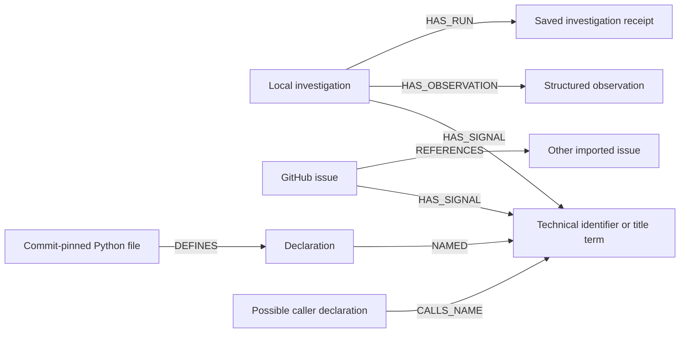

> Historical first pilot: repository selection and the 30-issue limit below have been superseded by [multi-repository onboarding and complete issue pagination](GITHUB_REPOSITORIES.md). The original verification receipts remain unchanged.

# CaseRoute: one-repository GitHub pilot

Repository: **getzep/graphiti**. Inspired by TraceFix's repository-scoped, read-only lead search and observation-driven memory, implemented in CaseRoute's own Python/FastAPI workflow. The TraceFix directory was inspected read-only; its environment file and database were not used.

The pilot investigates existing reports and new, unpublished problems against a bounded graph of public issues and Python declarations. It does not run repository code, verify fixes, generate patches, open pull requests or publish GitHub issues.

## Use the interface

Open **GitHub pilot** in CaseRoute at http://localhost:8010.

1. Sync recent issues and a bounded Python snapshot. A successful snapshot records its commit and coverage.
2. Search cached issues by keywords, `#2014`, or a full `https://github.com/getzep/graphiti/issues/2014` URL. Enable **Search GitHub now** for fresh public evidence. Keywords are sent to GitHub only in that mode; a direct lookup refreshes the issue and first ten comments.
3. Inspect the original source. **Investigate this report** opens a local case and excludes the source report from related-issue retrieval.
4. Alternatively, use **Open a new investigation** with symptoms, expected/actual behavior, installed version and reproduction. It queries local graph evidence first; it does not publish the report or automatically send it to GitHub search.
5. Inspect shared-signal paths, source declarations, possible caller names and executed Cypher. Optional LLM review sends bounded report/evidence excerpts to the configured provider and makes at most one decision call.
6. Record a structured observation. A rejected lead or missing-information observation changes the next step to request details. Reload the page and reopen the saved case to see memory persist. A stale observation revision returns HTTP 409.

## New-issue handling

Use two concepts: a **source issue** is a public GitHub record, while an **investigation** is the user's current problem. A new report belongs in `RepoIntake`; it never becomes a searchable source issue merely because CaseRoute generated a recommendation. This prevents the system retrieving its own unverified guesses as evidence.

When the graph lacks a convincing lead, ask for missing reproduction/version details. Users can separately run a narrowly scoped live search, read/refresh a source, and rerun the saved investigation. A positive observation means useful lead, not confirmed resolution. Current observation notes are stored rather than interpreted as causal facts.

Recommended next freshness step: webhook-driven issue updates and incremental commit indexing. Current freshness is manual sync, refresh and live search, with visible checked timestamps and a ten-minute live-search cache. No webhook server or background synchronizer is claimed.

## What is in the graph

A separate graph, `caseroute_github` by default (`CASE_GITHUB_GRAPH` override), keeps this pilot distinct from Spark history and the fictional ownership lab.



Shared issue paths are ranked by `sum(input_weight * issue_weight / issue_signal_degree)`. Code declarations are ranked with degree-discounted identifier overlap. Qualified names also have lower-weight short aliases. Title terms help natural-language inputs; they are lexical connections, not verified semantic relationships. Multiple shared tokens are not independent corroboration.

Python AST parsing indexes classes, functions and method declarations, plus names appearing in calls. `CALLS_NAME` includes names in nested bodies and can be ambiguous; it is not a resolved call graph or proof of a runtime dependency. Imported code is never executed. Code paths link to a fixed commit; only active files at the current snapshot are queried. Earlier snapshots and saved investigation evidence remain distinguishable.

## Bounds and observed live check

The live check on 18 October 2026 imported:

- **30 recent public issues**, including open and closed states, excluding pull requests.
- **16 active Python files out of 236 eligible files**; 382,760 source bytes downloaded for the balanced snapshot.
- Commit **a107b622205733c0a53617ce0cd79fe4461cdb35**.
- Selection covers entry points, search, FalkorDB operations and tests. This is partial coverage, not full-repository understanding. Individual files are capped at 200 KB; a code import is capped at 3 MB; up to 100 declarations are indexed per file.

The API snapshot records the repository's `Apache-2.0` code license metadata. That is not a blanket licensing claim for user-authored issue comments. Issues/comments remain attributed to their source URLs and timestamps. Issue bodies are capped at 12,000 characters; refresh retrieves the first ten comments with 4,000-character bodies. Comments are displayed as source evidence but are not currently indexed into the ranking graph.

A browser check follows real issue **[#2014](https://github.com/getzep/graphiti/issues/2014)** to `SearchResults.merge`, excludes its self-hit, saves a rejection, reloads it, and observes `request_details`. A newly typed report retrieves issues and source declarations with zero GitHub or LLM requests. One optional live AnyAPI review passed one call; it requested additional details and cited the source issue. This verifies the integration, not diagnosis quality.

The first attempted code selection overemphasized FalkorDB files; a balanced selection fixed missing entry-point/search coverage. The unresolved MCP `add_memory` case demonstrates the scope limit: MCP server code outside the snapshot is not automatically understood. Do not present missing matches as proof that the issue has no code location.

## API calls and credentials

| Operation | GitHub requests | LLM requests |
| --- | --- | --- |
| Full bounded sync | Up to 20: metadata, issue search, commit, tree and 16 blobs | 0 |
| Local search / new graph-only investigation / reload | 0 | 0 |
| Live keyword search | 1; a ten-minute cache hit uses 0 | 0 |
| Refresh issue / live direct-number lookup | 2: issue and comments | 0 |
| Optional model review | 0 | At most 1; insufficient evidence skips it |

Provider failures are shown explicitly, with no substitute model decision. Successful model receipts are counted separately from failures; failed provider attempts can still consume a request.

`GITHUB_TOKEN` or `GH_TOKEN` may be configured in the local environment/ignored `.env`. If absent, an installed authenticated GitHub CLI session is used when available. Public unauthenticated reads are also supported, subject to GitHub rate limits. Credentials are used only against the fixed HTTPS GitHub API host, never stored in graph receipts or printed. All client requests use GET. The pilot is fixed to one public repository and rejects foreign issue URLs.

## Setup and verification

```powershell
python github_pilot.py sync --receipt artifacts/github-sync.json
python github_pilot.py search add_episode
python github_pilot.py search FalkorDB --live
python github_pilot.py refresh 2014
python github_pilot.py status
```

Use the normal CaseRoute Docker/Python setup first. The CLI and web interface share the same pilot graph. Core files: `github_client.py`, `repo_pilot.py`, `github_pilot.py`, `app.py`, `static/repo.js`.

All 36 existing backend checks and 11 pilot checks pass (47 total). The backend suite covers repository scope, static parsing without execution, balanced file selection, new-report issue/code paths, source exclusion, fresh-client reload, rejected-lead memory, stale writes, direct lookup, refreshed references, snapshot filtering and search caching. Browser verification: `python tests/browser_repo_check.py` with Playwright/Chromium and an imported pilot snapshot. It owns a temporary API process and saves clearly marked local acceptance cases; it makes no model calls or GitHub writes.

Receipts: [sync](submission/verification/github-sync.json), [browser](submission/verification/github-browser.json), [one-call LLM smoke](submission/verification/github-llm-smoke.json).

Future issue-fixing work should add an isolated reproduction/test environment and a reviewer-visible patch. A useful source path or an LLM-selected step does not establish that a patch works.
