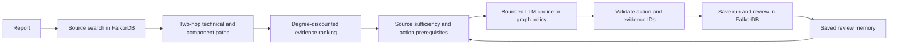

# Why the 20-case baseline failed, and the first graph-guided improvements

The baseline demonstrated working storage, traces and review memory, but weak investigation decisions. It evaluated the deterministic graph policy, not AnyAPI or a stronger LLM. A better model alone would still receive weakly ranked context.

| Baseline problem | Evidence | Implemented response |
| --- | --- | --- |
| Action depended mainly on number of component mentions | R03 dependency failure; R04 incidental Scheduler/Shuffle frames | Source sufficiency, report type, explicit missing-class/module checks and primary-component prerequisites |
| Missing information did not force clarification | 0/8 required abstentions | Sparse/title-only evidence gate; short performance proposals request measurement context |
| Version neighbors sorted by issue ID | `find_shared_version_reports` in the original source | Rank shared-version results by title overlap; keep them labeled weak context |
| Broad shared components lacked specificity | Same component can connect thousands of unrelated reports | Degree-discounted component intersections and new technical-identifier paths |
| Search relevance did not establish action quality | 10/20 useful non-self search hits, 6/20 acceptable actions | Separate retrieval scores, permitted actions and content judgments |
| Citations were valid but could support little | 20/20 citation membership; original source was cited in every graph-only result | Supply the LLM path excerpts and ranked non-self reports, retaining server-side validation |

## Graph algorithm and provenance

The new derived model is `HistoricalIssue -HAS_SIGNAL {matched, field, excerpt, rule, weight}-> EvidenceSignal`.

Identifiers include dotted APIs, mixed-case class/test names and underscore identifiers. They are extracted from titles and the first 12,000 characters of descriptions, capped at 24 per report. Values normalize to their last two dotted segments; exact matched source strings and surrounding excerpts are retained. This can merge unrelated identifiers and is a retrieval heuristic, not semantic entity resolution. Stack frames, including numbered/log-prefixed Java frames, are excluded. A long-line regression check ensures the match is inside the bounded excerpt.

FalkorDB computes a source-local shared-neighbor score:

`score(source, candidate) = sum(source_edge_weight * candidate_edge_weight / signal_degree)`

Title edges have weight 3; description edges have weight 1. Signals connected to more than 500 reports are excluded from this retrieval. The query traverses `issue -> identifier <- other issue`, excludes self-hits, returns up to eight candidates and sorts contributing paths for inspection. A rare title identifier connected to two reports contributes 9/2; one connected to 20 contributes 9/20. These are explicit heuristic weights and limits, not tuned probabilities.

The full real corpus has **75,232 derived signal edges** across **33,168 identifier nodes**. Every stored signal excerpt was checked to contain its matched text. Enrichment replaces only the derived signal edges for processed issues and recalculates degrees; it preserves source reports and reviews. It is a local batch index, not a transactional concurrent ingestion pipeline. Run `python evidence_graph.py` after an older import. Fresh `python import_real_data.py` builds it automatically.

This is weighted local shared-neighbor retrieval, **not PageRank**. Global centrality alone would answer structural importance rather than task relevance. Native Cypher traversals supply the algorithm; no external vector database, fabricated dependency edges or model-written Cypher is introduced. [FalkorDB Cypher functions](https://falkordb.github.io/docs-staging/cypher/functions/) and [algorithms](https://falkordb.github.io/docs-staging/algorithms/) document the available primitives. No comparative speedup is established.

## Agent and LLM flow

The LLM still has two bounded stages, rather than an open-ended autonomous tool loop. Planning produces exact search terms. The decision receives ranked candidates, at most three path excerpts per candidate, source context, primary components, review memory and allowed steps. Its JSON schema narrows both citation IDs and actions, and the server validates the result again. Sparse or previously rejected evidence forces clarification and skips the decision-model call; the planning call can still occur. Provider errors remain visible.

The UI now shows **Why these related reports?** with scores, supporting paths, source/candidate excerpts and the executed query receipt. The existing full-corpus canvas remains a projection of the source/component/version graph; the new technical index is shown in the evidence panel and traces, not silently included in its old 20,361-node count.

## Results and remaining failures

| Check | Frozen baseline | Current v3 development replay |
| --- | --- | --- |
| Matches prewritten acceptable action IDs | 7/20 | 18/20 |
| Requests clarification when prelabel requires it | 0/8 | 7/8 |
| Post-run human/AI content acceptability | 6/20, original AI review | Not regraded |
| Useful non-self top-five lexical search hits | 10/20, original AI review | Not regraded; new graph retrieval is a different output |

**The replay is in-sample development, not independent accuracy.** These cases motivated the changes. Both the first v2 replay (16/20 agreement, 6/8 clarification) and the v3 replay are retained in `evaluation/development/`. The original labels, predictions, post-review and summary remain byte-for-byte unchanged; receipts record their hashes. Do not present 18/20 as a generalization score or combine an old graph-only baseline with a new LLM condition as a controlled model comparison.

Remaining disagreements:

- **R12, assertDataFrameEqual migration:** the new policy treats the substantial migration rationale as sufficient to inspect the original change. The prelabel required clarification about target tests/schema. Better task-scope questions and independent review are needed; the label was not changed.
- **R18, usage logger/static methods:** generic environment verification still misses the precise logger attachment boundary. Component co-occurrence and identifier retrieval do not establish that mechanism. An LLM can inspect those excerpts, but that capability has not been validated across cases.

R03 now prioritizes the explicit dependency error rather than component count. R04 excludes incidental Scheduler/Shuffle mentions, and the technical graph finds actual MLflow doctest reports. These are concrete behavior checks, not verified diagnoses or fixes.

## Verification and next experiment

All **36 backend tests** pass, including rare-vs-hub ranking, self exclusion, idempotent enrichment, numbered stack frames, long source lines, missing-dependency priority, skipped decision calls and an attempted LLM prerequisite bypass. A browser check passes real ranked evidence, query receipts and absence of Scheduler/Shuffle in the selected MLflow action. A fresh Windows full import passes, including all 75,232 supported signal excerpts and preserved memory behavior.

One real AnyAPI investigation passed both planning and decision calls and chose `check_environment` within the allowed set. This is a smoke test, not LLM quality evaluation. Receipts are under `submission/verification/guidance-*.json`. The main published demo remains the earlier release snapshot; it does not demonstrate this new ranking panel.

Next, freeze a new report sample after this implementation is fixed, prelabel it without seeing outputs, and compare lexical-only evidence against lexical plus graph-ranked evidence with the same model and action gates. Judge path relevance, action adequacy, abstention and latency separately. For new-report discovery claims, remove test issues from the searchable graph and control the historical cutoff. The present work does not enforce such a held-out split.
